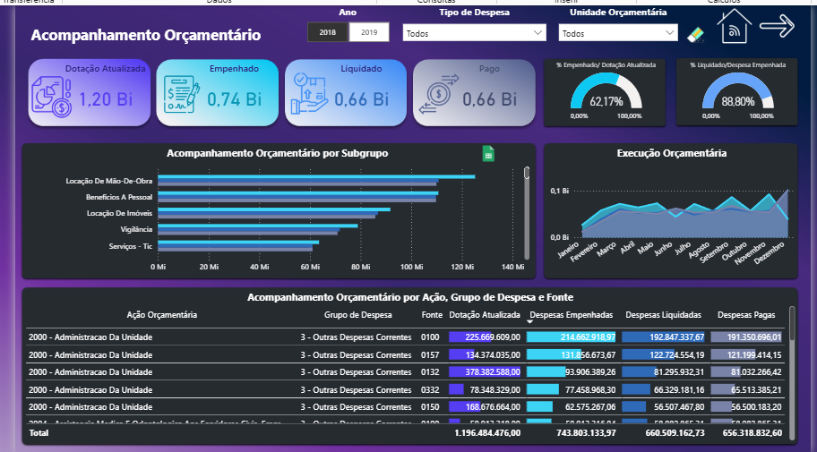
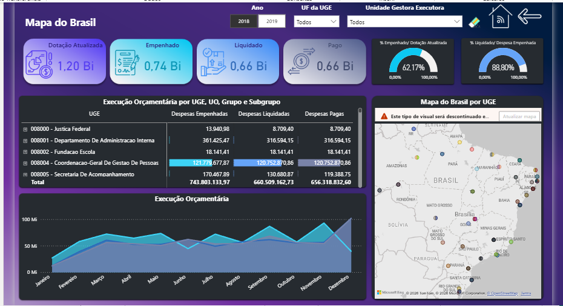
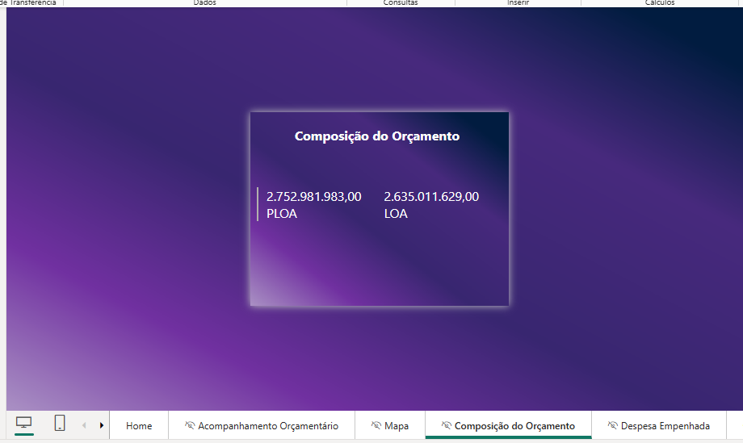
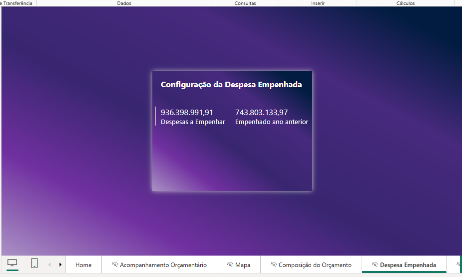
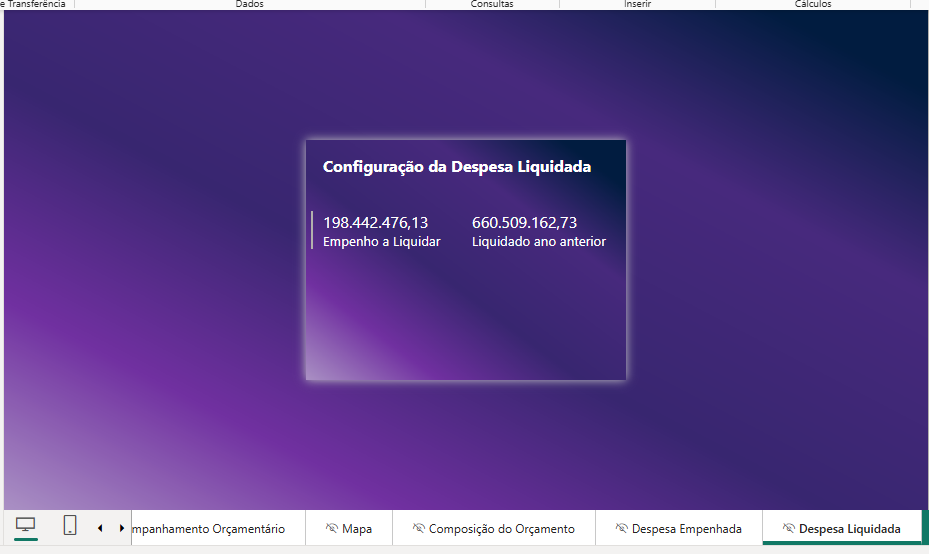

# 📊 Painel de Aprimoramento da Gestão — Power BI

Dashboard de acompanhamento orçamentário desenvolvido em Power BI,
utilizando Power Query, modelagem dimensional e DAX.

## 📸 Imagens do projeto

### Dashboard 1

### Dashboard 2

### Dashboard 3

### Dashboard 4

### Dashboard 5

### Dashboard 6

## 📁 Arquivo do projeto

Arquivo Power BI: `Painel Aprimoramento da Gestão.pbix`

## 👨‍💻 Autor

Cristhian Sabino Simplicio

[Meu LinkedIn](https://www.linkedin.com/in/cristhiansabinosimplicio/)
